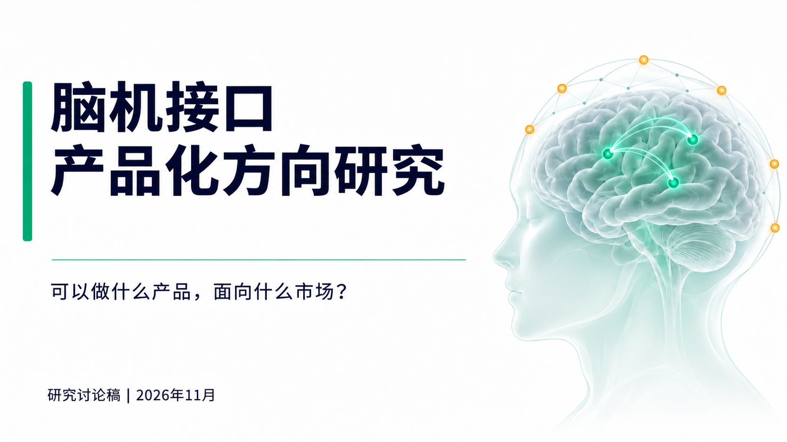
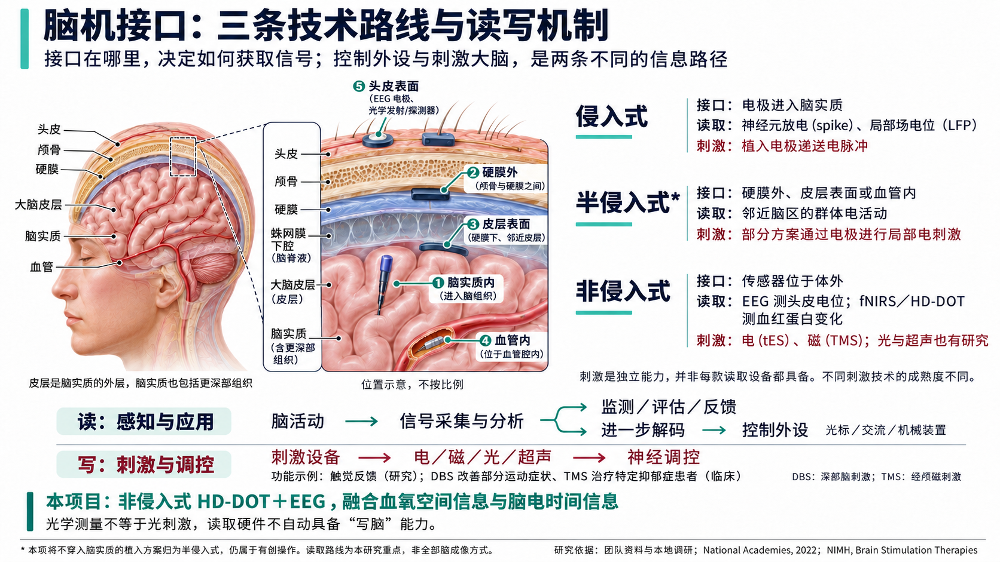
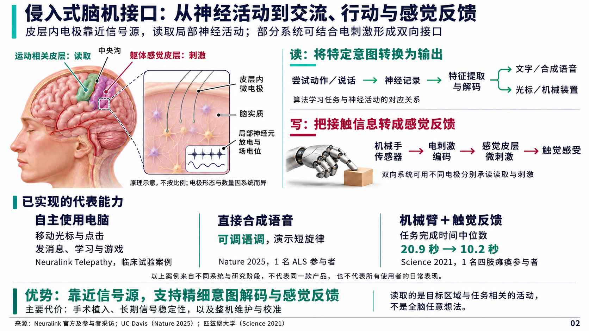
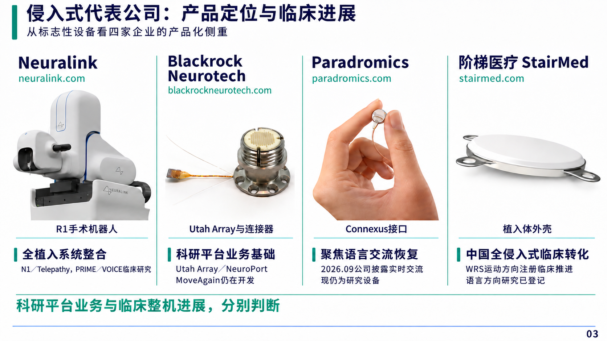
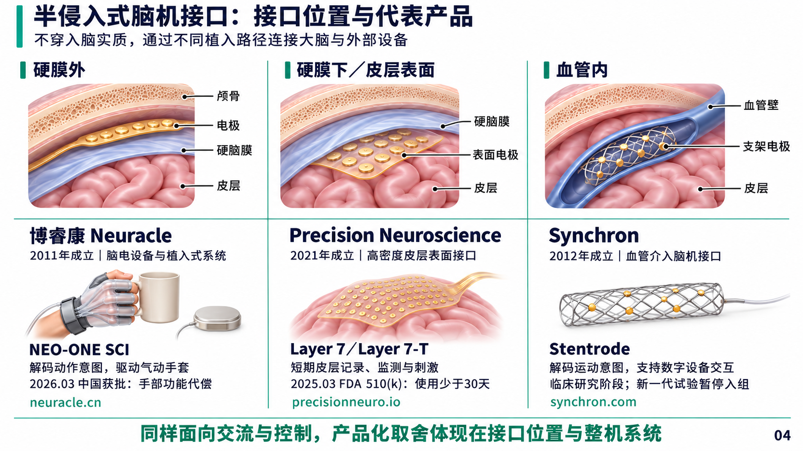
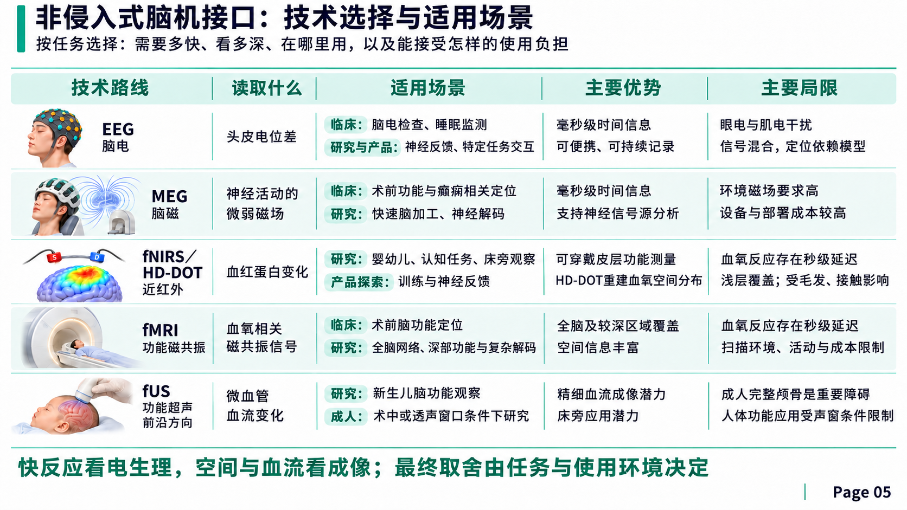
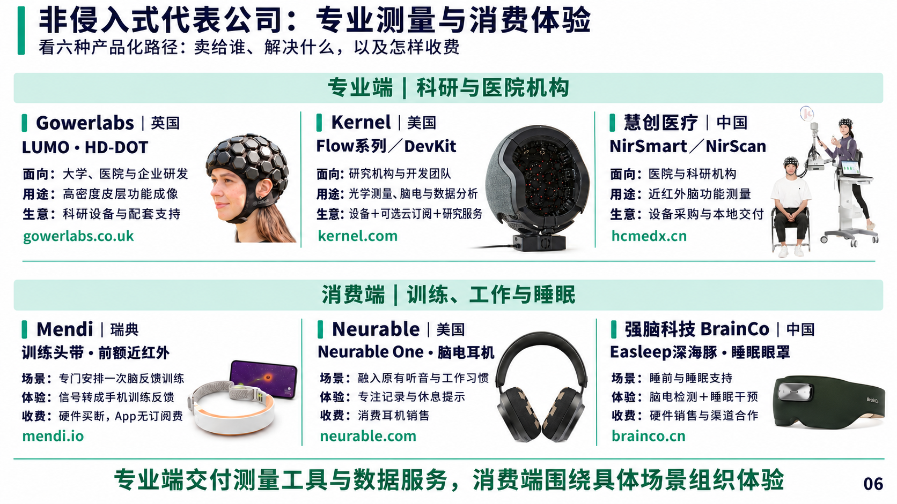
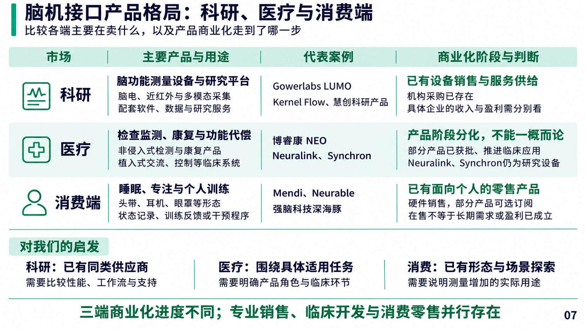
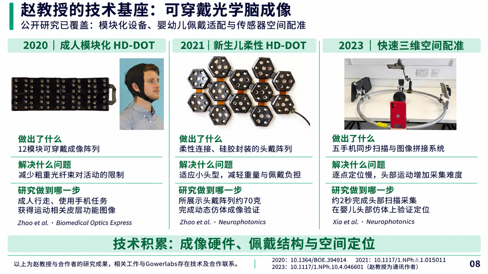
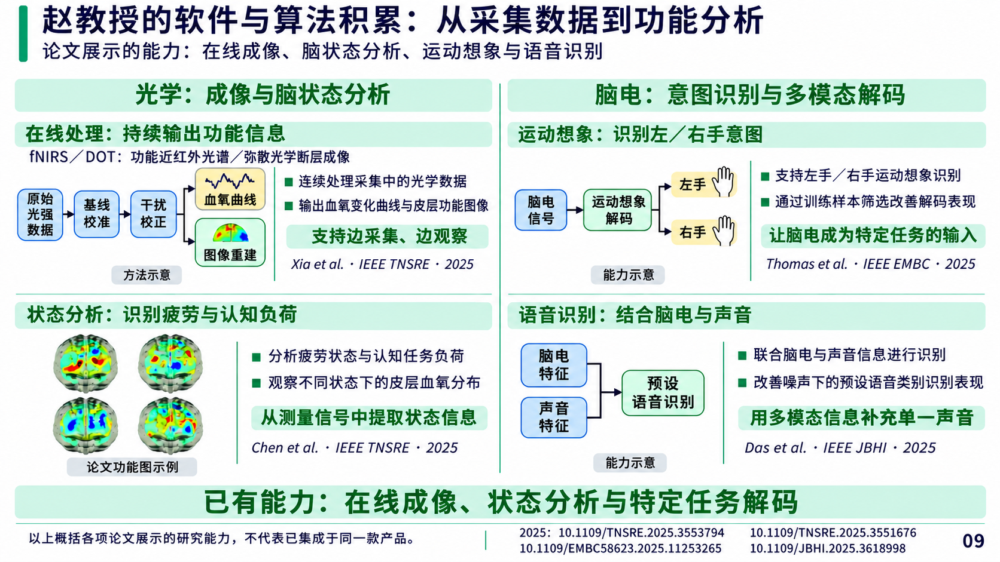

# 脑机接口产品化方向研究

## 当前PPT图片与讲稿汇总

整理日期：2026年11月14日。

本文件汇集已选定的封面、本轮采用的9页图片及对应讲稿，按讨论中确定的顺序整理，不另行重写内容。历史替代图和已放弃的页序不纳入。

- 封面及第1—7页：按2026年11月14日本次指令统一定稿。
- 第5页讲稿此前曾被搁置；本次按用户“前面的PPT和讲稿先定稿”指令，将最近暂存版本一并纳入。保留此前修订历史，不新增改写。
- 本次将定稿页面及讲稿同步至GitHub。

## 封面｜脑机接口产品化方向研究

**状态：已选定。**

封面问题：可以做什么产品，面向什么市场？

已删除教授背景副标题及问题行中的“我们”“分别”，正文页码维持不变。

## 页面目录与状态

| 页码 | 页面主题 | 当前状态 |
|---|---|---|
| 01 | 脑机接口：三条技术路线与读写机制 | 图片与讲稿定稿 |
| 02 | 侵入式脑机接口：从神经活动到交流、行动与感觉反馈 | 图片与讲稿定稿 |
| 03 | 侵入式代表公司：产品定位与临床进展 | 图片与讲稿定稿 |
| 04 | 半侵入式脑机接口：接口位置与代表产品 | 图片与讲稿定稿 |
| 05 | 非侵入式脑机接口：技术选择与适用场景 | 图片与讲稿定稿（本次统一确认） |
| 06 | 非侵入式代表公司：专业测量与消费体验 | 图片与讲稿定稿 |
| 07 | 脑机接口产品格局：科研、医疗与消费端 | 图片与讲稿定稿 |
| 08 | 赵教授的技术基座：可穿戴光学脑成像 | 图片与讲稿定稿 |
| 09 | 赵教授的软件与算法积累：从采集数据到功能分析 | 图片与讲稿定稿 |

---

## 第1页｜脑机接口：三条技术路线与读写机制

**状态：图片与讲稿定稿。**

### PPT图片

### 讲稿

这一页先建立一个技术框架：上半部分看接口在哪里，下半部分看信息怎样在大脑与设备之间流动。

先看左边的解剖图。头皮下面是颅骨，颅骨以内有包裹大脑的脑膜，硬膜是其中较外层的一层。粉色的脑组织就是脑实质，既包括外层的大脑皮层，也包括更深部的组织。图中放大的部分，展示了不同接口与这些结构的位置关系。

按照位置，这里把主要路线分为侵入式、半侵入式和非侵入式。

侵入式，是电极进入脑实质，接近神经元，可以记录神经元放电，也就是spike，以及局部场电位LFP。局部场电位反映附近神经群体的电活动。

半侵入式，在这里指不直接穿入脑实质的植入方案，包括颅骨与硬膜之间的硬膜外、硬膜以内的皮层表面，以及血管内。血管内接口通过介入方式放入血管腔，和直接穿入脑组织是两种不同的位置。这一分类便于我们比较路线，但半侵入式仍然涉及手术或介入。

非侵入式，是在体外采集信号。我们重点关注脑电和近红外光学两类。EEG，也就是脑电，测量头皮电位；fNIRS，也就是功能性近红外光谱，通过含氧和脱氧血红蛋白的变化，间接观察脑功能反应。HD-DOT是高密度漫射光学层析成像，利用密集、多距离的光学测量和模型重建，获得可及皮层的血氧变化空间信息。

接下来，看底部的读、写两条路径。

“读”，是把脑活动变成设备能够分析的信息。采集和分析之后，主要可以走向两类应用。

一类是监测、评估和反馈。例如观察某项任务中的脑活动，或者把测量结果转换成声音、画面，用于神经反馈训练。

另一类是在读取之后进一步解码，把特定脑信号转换成控制指令，让使用者移动光标、选择文字或操作机械装置。所以，控制外设是读取信号之后的一种应用。非侵入式也能完成特定任务下的控制，例如利用EEG识别预设选择或运动想象；不同路线在速度、自由度和稳定性上存在差异，后面会结合具体产品比较。

“写”，则是从设备向神经系统施加作用，主动影响神经活动，也就是刺激与神经调控。

从实现方式看，这里包括电、磁、光和超声。它们使用不同的物理方式影响神经活动，对应的功能也不完全相同。

第一种是电刺激。侵入式和部分半侵入式方案，通过植入电极递送电脉冲；非侵入式的经颅电刺激，也就是tES，则通过头皮电极施加电流。电刺激可以实现什么？在研究中，对感觉皮层进行电刺激，可以产生触觉感受。如果把机械手的接触信息转换成这种刺激，就能为脑控机械手提供感觉反馈。另一个例子是深部脑刺激，也就是DBS，它通过植入电极，帮助部分帕金森病患者改善震颤、僵硬等运动症状。

第二种是磁刺激。经颅磁刺激，也就是TMS，通过变化的磁场，在脑组织中感应电场，影响目标神经网络的活动。它已经用于特定抑郁症患者的治疗。

第三种是光刺激。这里主要指经颅光生物调节，也就是tPBM：使用特定波长和剂量的红光或近红外光作用于脑组织，其机制研究涉及细胞能量代谢及血流等变化。它的应用研究包括睡眠等方向。比如，2025年的一项随机对照试验，将30名慢性失眠成人分为光刺激组和假刺激组，评估睡眠质量、日间嗜睡和脑电指标。这说明光已经被用于具体的睡眠干预研究，而不只是测量信号。它与我们HD-DOT中用于测量血红蛋白变化的近红外光，目的、剂量和设备要求不同。

第四种是超声刺激。低强度经颅聚焦超声，也就是tFUS，把声学能量聚焦到选定脑区，通过机械作用等途径影响神经活动。它的重要特点是可以探索对部分深部脑区的非侵入式调控。功能上，已经有人体随机对照研究，探索它对抑郁症状和相关脑网络的影响，目前属于探索性临床研究。这里讲的是低强度神经调控，与用于成像的超声，以及用于消融的高强度聚焦超声，需要区分。

所以，电、磁、光和超声是四种不同的刺激方式；感觉反馈、运动症状调控、情绪和睡眠相关干预，则是它们各自正在实现或探索的功能。具体功能要对应具体技术和设备。DBS和TMS等神经调控系统，也可以独立于脑机接口使用。

因此，读和写代表两种信息方向。读取可以单独用于监测，也可以继续连接外设控制；刺激也可以单独工作。把采集、分析和刺激连接起来，根据测得的脑活动调整刺激，才形成闭环调控。

最后看我们的位置。赵教授的项目聚焦非侵入式HD-DOT与EEG融合：光学帮助观察血氧变化的空间分布，脑电捕捉快速的电活动变化。我们首先讨论的是这两类信息如何共同服务于脑活动感知，以及它们能够支持哪些具体产品。

如果未来进一步发展刺激功能，就要明确采用哪一种刺激模块。测量使用近红外光，与用光进行神经调控，是两项不同的能力。

后面的研究，将沿着这个框架逐条路线展开：它能读取什么、能支持哪些应用、是否能够施加刺激，以及这些能力已经做成了什么产品。

**参考链接（不朗读）**

- [光刺激与睡眠：2025年30人随机对照试验](https://doi.org/10.1007/s10103-025-04699-y)
- [超声刺激与抑郁：人体随机对照研究](https://pubmed.ncbi.nlm.nih.gov/39111747/)
- [电刺激与运动症状：NINDS，Deep Brain Stimulation](https://www.ninds.nih.gov/health-information/disorders/deep-brain-stimulation-dbs)
- [磁刺激：NIMH，Brain Stimulation Therapies](https://www.nimh.nih.gov/health/topics/brain-stimulation-therapies/brain-stimulation-therapies)
- [感觉皮层微刺激与触觉反馈研究](https://www.nature.com/articles/s41551-024-01299-z)

---

## 第2页｜侵入式脑机接口：从神经活动到交流、行动与感觉反馈

**状态：图片与讲稿定稿。**

### PPT图片

### 讲稿

上一页介绍了三条技术路线和读写机制。这一页先展开侵入式，也就是电极进入脑实质的路线，重点看它怎样工作，以及已经实现了什么功能。

先看左侧。皮层内电极进入目标脑区，记录神经活动产生的电位变化，系统再从中提取神经元放电、局部场电位等信号。它的优势是靠近信号源，但能获取哪些信息，取决于电极所在的位置和采集条件。

图中用运动相关皮层和躯体感觉皮层举例。中央沟前面的运动相关区域，可以提供动作意图相关的信号；后面的躯体感觉区域，可以作为触觉反馈的刺激位置。

具体植入哪里，要根据目标功能和个人的脑部情况，由临床与研究团队规划。例如，控制手部动作和直接解码说话，可以选择不同的目标区域。Neuralink的R1机器人主要负责把细电极线精确植入选定区域。

先看右上方的读取路径。使用者尝试动作或说话，电极记录神经活动；计算系统提取特征，再通过训练好的解码模型，输出文字、合成语音，或者控制光标和机械装置。

这里，硬件负责采集信号，算法学习神经活动与目标任务之间的对应关系。最终的能力来自植入位置、信号质量、训练数据和解码系统的共同作用。

**参考链接（不朗读）**

- [Neuralink：电脑控制的目标信号与使用方式](https://neuralink.com/trials/device-control/)
- [Neuralink：言语运动皮层与直接语音解码](https://neuralink.com/trials/speech-restoration/)
- [R1机器人与手术分工：Neuralink官方说明](https://neuralink.com/updates/prime-study-progress-update/)
- [神经外科医生直接说明目标选择与机器人执行，访谈约4小时20分处](https://lexfridman.com/elon-musk-and-neuralink-team-transcript)

这里的“读”和“写”，始终以大脑为参照。

“读”，是把大脑中的活动采集出来，交给外部系统分析和使用。刚才提到的电脑发声、机械手动作，都属于读取之后的输出。

“写”，则是设备向神经系统施加刺激，影响神经活动。在这张图里，具体指把机械手的接触信息转换成感觉皮层的电刺激，为使用者提供触觉反馈。

所以，同一只机械手可以同时出现在两条路径中：向外，是读取动作意图，让机械手运动；向内，是把机械手接触到的信息转换成刺激，让使用者产生触觉感受。两条路径承担不同的功能。

下面看三个具体案例。

第一个是自主使用电脑。Neuralink的Telepathy临床试验，让参与者通过想象手部动作，经过校准后控制电脑光标和点击。发消息、学习和玩游戏，都可以建立在这个输入能力上。它提供的是一条不依赖手部操作的数字输入通道，属于读取脑信号之后的应用。

这里还有一个容易忽略的区别：即使电极读取的是手部运动相关信号，使用者也可以通过光标选字，再让电脑把文字朗读出来。最后听到了合成语音，并不意味着系统直接读取了说话意图，也不意味着它向大脑施加了刺激。

**参考链接（不朗读）**

- [首位参与者Noland Arbaugh采访：Texas A&M，2024年6月3日](https://stories.tamu.edu/news/2024/06/03/aggie-is-neuralinks-first-brain-implant-participant/)
- [Neuralink官方用户体验与演示](https://neuralink.com/updates/prime-study-progress-update-user-experience/)

第二个是直接合成语音。这里采用了另一条输入路径：读取尝试说话时的神经活动，解码后直接合成声音。

2025年，UC Davis等团队在Nature发表的研究，在一名肌萎缩侧索硬化症，也就是ALS参与者的皮层内植入256个微电极，演示了连续语音合成、语调调节和短旋律。这项研究体现的，是从说话相关的神经活动到声音表达的转换。

它同样属于“读”。使用者听到扬声器发出的声音，是通过正常听觉获得反馈；这一过程没有因为出现“语音合成”就变成写脑。

**参考链接（不朗读）**

- [UC Davis官方报道：让ALS参与者实时“说话”，2025年6月11日](https://health.ucdavis.edu/news/headlines/first-of-its-kind-technology-helps-man-with-als-speak-in-real-time/2025/06)
- [原始论文](https://www.nature.com/articles/s41586-025-09127-3)

第三个是机械臂与触觉反馈。2021年的Science研究，把两条信息路径真正连接了起来。

一条路径从运动皮层出发：读取动作意图，解码成指令，控制机械臂抓取物体。另一条路径从机械手出发：传感器检测接触和抓握信息，把信息编码为电脉冲，刺激躯体感觉皮层，让参与者产生来自手部的触觉感受。后面这条路径，才是这个案例中的“写”。

在这名四肢瘫痪参与者的上肢任务中，加入触觉反馈后，成功完成试次的时间中位数从20.9秒降到了10.2秒。它说明，感觉反馈能够帮助使用者完成机械臂操作。这里控制的是外部机械臂，刺激提供的是触觉，不能把它理解为真实手臂已经恢复运动。

**参考链接（不朗读）**

- [匹兹堡大学官方报道：触觉反馈改善机械臂控制，2021年5月24日](https://www.engineering.pitt.edu/news/2021/adding-sense-of-touch-improves-control-of-robotic-arm/)
- [原始论文全文](https://pmc.ncbi.nlm.nih.gov/articles/PMC8715714/)

这三个案例，分别展示了电脑交互、直接语音表达，以及带触觉反馈的机械臂操作，来自不同的系统与研究阶段。

侵入式路线的优势，是靠近信号源，支持精细的意图解码，并有机会进一步加入感觉反馈。对应的工程问题包括手术植入、长期信号稳定性，以及持续使用中的维护和校准。

下一页，我们从功能转向公司与产品，比较国内外主要参与者采用什么系统，以及它们的临床和商业化进展。

---

## 第3页｜侵入式代表公司：产品定位与临床进展

**状态：图片与讲稿定稿。**

### PPT图片

### 讲稿

上一页介绍了侵入式脑机接口怎样实现电脑控制、语音表达和感觉反馈。这一页，我们进一步认识背后的代表公司：它们成立多久，长期聚焦什么，为什么在行业里重要，以及现在走到了哪一步。

先看Neuralink。它成立于2016年，是马斯克共同创办的脑机接口公司。它的特点是把柔性电极、植入体、手术机器人、无线通信和解码软件整合成完整系统，推动长期植入与实际使用。

图片中展示的是R1手术机器人，它负责精细植入电极线；真正留在人体内采集信号的是N1植入体。电脑控制方向的Telepathy，以及语音恢复方向的VOICE研究，都建立在这套技术体系上。

因此，认识Neuralink，重点要看它怎样把一条技术链变成完整的使用体验：从植入手术，到信号采集、软件解码，再到日常训练和使用。目前这些产品仍在临床研究阶段。

第二家是Blackrock Neurotech。它成立于2008年，最初名为Blackrock Microsystems，是皮层内脑机接口领域的重要基础供应商。

它所承接的技术历史比公司本身更久。Utah Array电极阵列的发明可以追溯到1989年，2004年就已用于BrainGate人体试验。因此，我们看到的是一条经过长期科研与人体研究积累的技术路线。

图中展示的是Utah Array与连接器，但Blackrock的业务不只是一块电极。它还提供信号采集硬件、处理软件和相关工具，让研究团队能够搭建自己的神经记录、刺激和解码系统。

这就是它作为行业基础平台的重要性：许多研究团队借助这些工具，开发交流、机械臂控制和感觉反馈应用。具体成果由研究团队、参与者、硬件和算法共同完成，而Blackrock提供了其中重要的基础设施。

商业上，它已经形成面向研究机构的产品供给，同时继续开发MoveAgain临床系统。所以，Blackrock需要同时看两层：已经积累起来的科研平台业务，以及正在推进的患者产品。

第三家是Paradromics。它成立于2015年，长期聚焦高数据率神经接口，目前的临床产品Connexus重点面向语言交流恢复。它关注的是怎样采集足够丰富的神经信息，并把这些信息稳定地转成使用者想表达的内容。

图片中可以看到手指间的Connexus接口。这是系统的一部分，完整系统还包括植入连接、通信、外部计算与解码设备。

根据公司披露，2026年6月完成首例长期植入，9月进一步公布首位参与者使用系统进行实时语音和文字交流，包括自主表达、回答问题和与家人通话。这些进展仍来自早期可行性研究。

Paradromics值得关注的地方，是围绕“恢复交流”这个明确需求，持续整合硬件、解码与输出体验。理解它的产品，应当看使用者能否更自然地表达，以及系统能否支持持续使用。

第四家是中国的阶梯医疗。它成立于2021年8月，核心基础是超柔性神经电极，并围绕电极发展植入系统、配套设备和临床应用。

图中展示的是植入体外壳组件。阶梯的完整产品能力，还包括电极、采集与通信、解码和脑控训练等环节。

它在这页中的主要代表性，是中国全侵入式脑机接口的临床转化。运动方向，WRS系统面向脊髓损伤者的脑控交互，已推进到注册临床；语言方向，也有中文语音神经假体研究的公开登记。

阶梯也提供科研工具，但这里更值得观察的是，它怎样从柔性电极这一核心技术，发展出可以进入临床流程的整套产品。

这四家公司各有侧重：Neuralink突出完整系统整合，Blackrock积累了深厚的科研平台基础，Paradromics聚焦语言交流产品，阶梯则代表中国柔性接口与临床转化的推进。

比较它们时，需要分别看科研工具业务和临床整机进展。成立时间帮助我们理解积累，核心技术帮助我们理解差异，具体产品与使用场景则帮助我们判断商业价值。

下一页，我们转向不直接穿入脑实质的半侵入式路线。

**参考链接（不朗读）**

- [Neuralink成立年份记录](https://www.sec.gov/Archives/edgar/data/1708503/000170850321000002/xslFormDX01/primary_doc.xml)
- [Neuralink技术介绍](https://neuralink.com/technology/)
- [Neuralink电脑控制](https://neuralink.com/trials/device-control/)
- [Neuralink语音恢复](https://neuralink.com/trials/speech-restoration/)
- [Blackrock公司历史](https://blackrockneurotech.com/our-story/)
- [Blackrock科研产品目录](https://blackrockneurotech.com/products/)
- [MoveAgain说明](https://blackrockneurotech.com/our-tech/)
- [Paradromics公司资料](https://uploads-ssl.webflow.com/624f33634a4c101536ff95a5/644a8a75ff37a09274ef0572_PARA-factsheet-042623.pdf)
- [Connexus介绍](https://paradromics.com/connexus/)
- [Paradromics公司进展公告](https://paradromics.com/news/paradromics-achieves-real-time-speech-connexus-brain-computer-interface/)
- [阶梯公司介绍](https://www.stairmed.com/en/jietijianjie.html)
- [阶梯创始人采访](https://epaper.cs.com.cn/zgzqb/html/2026-11/11/nw.D110000zgzqb_20261111_4-A07.htm)
- [阶梯语言研究登记](https://clinicaltrials.gov/study/NCT07647315)

---

## 第4页｜半侵入式脑机接口：接口位置与代表产品

**状态：图片与讲稿定稿。**

### PPT图片

### 讲稿

前面我们已经介绍了读取、外设控制和刺激的基本机制。这一页不再重复这些流程，重点看另一种产品选择：电极不直接穿入脑实质，而是放在硬膜外、皮层表面，或者血管内部。

这份报告把这三种位置归在“半侵入式”中。它们仍然需要植入；在监管文件里，也可能被统称为侵入式。

先看左边的硬膜外路线。

电极位于颅骨下面、硬脑膜上面，隔着硬脑膜记录皮层电活动。对应的代表公司是博睿康，也就是Neuracle。

博睿康成立于2011年，长期面向科研和医疗提供脑电设备，并逐步发展植入式脑机接口。因此，它既有神经信号采集设备的积累，也在向患者使用的完整系统延伸。

它的NEO系统读取动作意图，再控制外部气动手套，辅助使用者完成抓握、取物等动作。2026年3月，相关手部运动功能代偿系统获得中国药监部门注册批准，面向特定脊髓损伤人群。这里已经形成了比较明确的产品组合：植入接口、解码系统，以及执行动作的辅助手套。

再看中间的皮层表面路线。

电极放在硬脑膜下面，贴合皮层表面，但不直接刺入脑组织。这里选择的代表公司是Precision Neuroscience。

Precision成立于2021年，聚焦高密度皮层表面接口。它的Layer 7采用薄而柔软的电极阵列，通过密集触点采集皮层表面的电活动。

理解它的产品进展，要区分电极器械和长期脑机接口整机。2025年3月获得FDA 510(k)许可的是Layer 7-T，用于少于30天的皮层表面电信号记录、监测和刺激。这为进入临床工作流程提供了一个入口，但不能直接等同于长期居家使用的交流或控制系统已经获准销售。

最后看右边的血管内路线。

Synchron成立于2012年，长期聚焦通过血管介入递送脑机接口。它的Stentrode形态类似支架，沿血管送入靠近运动皮层的颅内静脉，从血管内部记录附近的神经活动。

它面向严重运动障碍人群，希望通过解码运动意图，支持电脑、平板等数字设备的交互。它的产品思路很鲜明：借鉴血管介入的递送方式，建立一条连接大脑和数字设备的通路。目前，Stentrode仍属于临床研究设备，尚未获准商业销售。

这里也补充一个近期变化：根据11月12日的报道及公司回应，新一代系统因连接导线的性能问题，暂停了试验入组，正在进行硬件升级。这也说明，植入路径之外，导线、通信和整机可靠性同样影响产品推进。

把这三家公司放在一起，可以看到三种不同的产品化侧重：博睿康把接口与辅助手套组成手部功能代偿系统；Precision从皮层表面电极及短期临床应用切入；Synchron通过血管介入，推进面向数字设备交互的系统。

因此，我们比较这些路线时，既看电极放在哪里，也看它最终与什么设备、软件和使用流程组成一个产品。

接下来，我们转向与我们项目直接相关的非侵入式路线。

**参考链接（不朗读）**

- [博睿康公司背景](https://kjc.changzhou.gov.cn/html/kjc/2016/IBPDMDOC_1026/3816.html)
- [药监部门介绍](https://yjj.sh.gov.cn/zjyw/20260313/04985a5fbe284e9c806ff5f370cb00b2.html)
- [国家医保局产品介绍](https://www.nhsa.gov.cn/art/2026/3/22/art_14_19989.html)
- [Precision公司成立背景](https://downloads.regulations.gov/NIST-2022-0002-0079/attachment_1.pdf)
- [Precision技术介绍](https://www.precisionneuro.io/our-technology)
- [FDA原始文件](https://www.accessdata.fda.gov/cdrh_docs/pdf24/K242618.pdf)
- [Synchron公司背景](https://app.dealroom.co/companies/synchron)
- [Synchron官方技术介绍](https://synchron.com/technology)
- [Synchron当前产品说明](https://synchron.com/)
- [近期报道及公司回应](https://www.wired.com/story/synchron-pauses-trials-of-its-brain-implant-due-to-performance-issues/)

图像说明（不朗读）：本页设备为示意绘图。信息核查日：2026-11-14。

---

## 第5页｜非侵入式脑机接口：技术选择与适用场景

**状态：图片与讲稿定稿（本次统一确认）。**

### PPT图片

### 讲稿

> 本次统一定稿沿用此前暂存的最近版本；历史修订记录保留。

这一页，我们要回答的是：同样是不植入大脑，为什么有些设备适合放在医院床旁，有些需要专门的扫描环境，还有些能做成日常佩戴的头带或帽子？

关键不只是测得准不准，还包括：人能不能移动、设备需要什么环境、准备一次要多久，以及这个任务到底需要什么信息。

先看床旁场景。

例如，新生儿、行动不便的人，或者需要连续观察的患者。我们通常希望把设备带到人身边，而不是频繁把人送进扫描仪。

这时，EEG，Electroencephalography，也就是脑电测量，以及fNIRS，functional Near-Infrared Spectroscopy，也就是功能近红外光谱，就有设备形态上的优势：它们可以通过头部传感器和便携采集设备工作，不必依赖大型扫描仪。

但它们适合回答的问题不同。

如果想持续观察电活动、睡眠阶段或快速反应，脑电更直接。如果想观察某项任务前后，所覆盖皮层的血氧反应怎样变化，近红外可以提供另一类信息。

HD-DOT，High-Density Diffuse Optical Tomography，高密度漫射光断层成像，则进一步通过密集光学测量，重建血氧变化的空间分布。

所以，床旁选择它们，首先是因为设备可以靠近患者、支持重复或持续测量；至于能否完成某项诊断或评估，还要看具体系统和应用，不能仅凭“能在床旁测”就推导出来。

再看专业检查和实验室场景。

有些问题需要更广的脑区覆盖、更丰富的空间信息，或者对快速信号来源进行专门分析。这时，我们可能愿意接受更复杂的设备和环境，换取所需要的信息。

例如，fMRI，functional Magnetic Resonance Imaging，功能磁共振成像，可以观察全脑及较深区域的功能分布。但它依赖大型扫描设备，使用者需要进入扫描仪，并尽量保持不动。

因此，它适合预约完成的脑功能检查和研究；如果产品要求用户在家每天戴着使用，这种设备形态就不合适。

MEG，Magnetoencephalography，脑磁图，能够捕捉快速神经活动，并结合模型分析信号来源。但脑磁信号非常微弱，外界磁场容易淹没它，所以通常需要专门的磁屏蔽和环境控制。

这就是为什么脑磁虽然也能做成头盔形态，仍不能直接当成普通消费头盔。戴得上，与能在家稳定工作，是两回事。

然后看日常佩戴场景。

到了家里或办公室，用户通常不会接受很长的准备时间，也不希望有人反复调整传感器。产品需要轻、好戴、容易获得稳定信号，并且收益值得用户每天花时间使用。

所以，一些脑电和近红外产品会选择头带、耳周设备或局部传感器，减少佩戴与准备负担。但这样的简化也意味着，覆盖位置和能获得的信息受到限制。

例如，近红外产品选择额头，一个重要原因是那里毛发少，比较容易建立光学接触。它更容易使用，却不意味着能观察整个大脑。高密度脑电帽或HD-DOT系统虽然能增加测量信息，也可能增加佩戴、接触检查和维护的工作。

因此，日常产品不是把科研设备缩小就行，而是要判断：为这个具体用途保留多少测量能力，用户又愿意承担多少使用负担。

最后看fUS，functional Ultrasound，功能超声。

它通过微血管血流变化观察脑功能，具有床旁成像潜力，但这里还有一个决定场景的条件：声音能否有效穿过颅骨。

新生儿尚未闭合的囟门可以提供声窗；成人完整颅骨则会带来重要障碍，一些人体研究需要术中条件或手术建立的透声窗口。因此，它能否走向某种产品，不仅取决于仪器大小，也取决于使用者的解剖条件。

回到这张表，技术选择可以归纳为三个问题：

需要把设备带到患者身边，就重视便携和持续测量；需要全脑或专业定位信息，就可能接受专门的检查环境；需要每天使用，就必须把佩戴、准备和维护负担一起算进去。

没有一种路线在所有条件下都最好。我们真正要找的是：为了完成一个明确任务，哪些信息不可少，而用户为获得这些信息，需要付出多少时间、成本和操作负担。

下一页看代表公司时，我们就用这个标准来判断：它们为什么选择这种技术和产品形态，以及它们究竟为客户解决了什么问题。

**参考链接（不朗读）**

- [NIH脑电检查资料](https://www.ninds.nih.gov/sites/default/files/2025-05/NINDS_Neurological-Diagnostic-Tests-Procedures.pdf)
- [NIH脑磁图介绍](https://www.nimh.nih.gov/research/research-conducted-at-nimh/research-areas/research-support-services/meg)
- [临床脑磁实践指南](https://pmc.ncbi.nlm.nih.gov/articles/PMC6045462/)
- [可穿戴近红外应用](https://www.gowerlabs.co.uk/lumo)
- [HD-DOT原始研究](https://pubmed.ncbi.nlm.nih.gov/33842667/)
- [功能磁共振解码原始研究](https://www.nature.com/articles/s41593-023-01304-9)
- [人体功能超声原始研究](https://pubmed.ncbi.nlm.nih.gov/38809965/)

---

## 第6页｜非侵入式代表公司：专业测量与消费体验

**状态：图片与讲稿定稿。**

### PPT图片

### 讲稿

上一页讲的是不同技术适合什么任务。这一页，我们进一步看：企业怎样围绕技术选择客户，并形成产品和收费方式。

上面三家公司主要面向专业机构，下面三家则展示了消费产品的不同路径。

先看Gowerlabs。

它成立于2013年，长期聚焦可穿戴光学脑成像。LUMO采用模块化高密度光学设计，可以根据研究对象、目标脑区和实验任务配置测量布局。

它主要卖给大学、医院研究团队和企业研发部门。这些客户购买设备，是为了完成实验、获得数据，并支持自己的研究。因此，他们关心的不只是戴起来怎么样，还包括能否调整布局、获得合格信号，以及接入分析流程。

Gowerlabs代表的是科研仪器路径：把成像能力做成专业团队能够使用的工具。这也是它与我们技术关联最直接的地方。

第二家是Kernel。

它成立于2016年，提供Flow系列设备、开发套件，以及配套的数据平台和研究服务。当前Flow 2除了时域近红外模块，也配置了脑电。

Kernel值得关注的地方，是把业务延伸到了设备使用之后。研究团队除了购买硬件，还可以使用数据采集、质量检查、存储和开发工具，并按需要购买云订阅或研究服务。

例如，一个团队想开展脑功能研究，困难可能不在于买不到传感器，而在于怎样设计任务、组织采集、处理数据，并让不同批次的数据能够比较。Kernel试图把这些环节一起提供。

所以，它代表的是设备加数据平台、再加专业服务的路径。数据积累有战略价值，但不能直接把它理解成已经主要靠出售数据盈利。

第三家是中国的慧创医疗。

它的NirSmart、NirScan等产品面向医院和科研机构，提供近红外脑功能测量及配套分析工具。公开采购记录中，已经可以看到医院购买相关设备的项目。

把慧创放在这里，是因为我们还需要理解中国机构市场：客户如何提出需求，采购什么配置，以及设备怎样进入院内或实验室的工作流程。

这条路径的产品能力，既包括测量和软件，也包括安装、培训、维护和本地交付。对一家准备在中国创业的公司，这些都是需要研究的商业环节。

再看下面的消费产品。这里选三种不同的使用方式：专门训练、融入日常，以及围绕睡眠使用。

第一种是Mendi。

它把前额近红外测量与手机训练结合。用户需要专门安排一段时间，戴上头带，根据应用中的反馈完成训练。

因此，它的产品重点，是把用户看不懂的测量信号，转成可以参与、可以重复的训练过程。它采用硬件买断的方式，目前官网说明应用没有订阅费。

这条路径需要建立一个新的使用习惯：用户为什么愿意今天练，明天还继续练。反馈是否清楚、过程是否容易开始，以及用户能否感受到值得持续的收益，都很关键。

第二种是Neurable的脑电耳机。

它选择把传感器放进用户本来就会使用的耳机里。当前官网产品是Neurable One；此前的MW75 Neuro已被标为停售，但继续提供支持。

它提供专注记录、休息提示等功能。与训练头带相比，它的产品思路是减少额外动作：用户听音乐、工作或使用降噪耳机时，同时完成脑电采集。

因此，它代表的是把脑机功能嵌入已有消费品的路径。耳机本身先有使用价值，脑电功能再争取提供额外价值。它仍然需要让用户理解：这些记录和提醒，究竟怎样帮助自己安排工作或休息。

第三种是强脑科技的Easleep深海豚。

它围绕睡眠设计产品，采用眼罩或绑带等形态。企业资料将其定位为脑电检测与声、光、电干预相结合的系统，具体配置需要按型号区分。

它与前两者的区别，是购买理由更直接地指向睡眠需求。用户首先关心入睡与休息体验，然后才关心背后的传感器和算法。

因此，这条路径的重点是把检测、干预、佩戴和应用组织成一个完整的睡前使用过程。硬件销售之外，睡眠相关渠道合作也是值得观察的商业入口。

这六家公司展示的，并不是六种孤立的硬件，而是不同的客户关系。

专业机构购买的是测量工具、数据能力和工作流程；消费用户则围绕训练、工作或睡眠，决定自己是否愿意购买和持续使用。

对我们来说，需要从中借鉴的是：技术最终怎样进入用户的生活或工作，测量结果怎样变成有用的输出，以及谁愿意为这个输出付费。

下一页，我们再回到自己的技术基础和产品选择。

**参考链接（不朗读）**

- [Gowerlabs公司历史](https://www.gowerlabs.co.uk/about-us)
- [LUMO产品](https://www.gowerlabs.co.uk/lumo)
- [Kernel系统、订阅与服务](https://www.kernel.com/developers)
- [慧创产品配置与实物资料（渠道来源）](https://www.champmed.cn/prod/50.html)
- [慧创医院采购记录](https://www.ccgp.gov.cn/cggg/dfgg/zbgg/202608/t20260806_27082697.htm)
- [Mendi产品与收费方式](https://www.mendi.io/products/mendi)
- [Neurable One产品与使用流程](https://www.neurable.com/products/neurable-one)
- [MW75 Neuro状态](https://www.neurable.com/products/mw75neuro)
- [强脑科技官方产品手册](https://wrc.cie.org.cn/profile/robot/download/2025/07/21/20250721112107000522_20250721112107A113.pdf)
- [强脑科技官方产品页面](https://www.brainco.cn/health/easleep)

**图片素材说明（不朗读）**

耳机与眼罩在最新图中依据Neurable官网及强脑科技官方手册素材替换；慧创使用渠道实物资料。页面由图片生成工具排版，非原始照片文件的逐像素拼版。

---

## 第7页｜脑机接口产品格局：科研、医疗与消费端

**状态：图片与讲稿定稿。**

### PPT图片

### 讲稿

前面我们按技术路线介绍了代表公司和产品。这一页把它们放回三个市场：科研、医疗和消费端，看看目前各端主要形成了什么产品，以及商业化走到了哪一步。

先看科研端。

我们调研到的产品，主要是脑功能测量设备和研究平台，包括脑电、近红外、多模态采集，以及配套的分析软件和研究服务。

这一端已经存在设备销售业务。Gowerlabs销售LUMO成像系统；Kernel在设备之外，还提供可选云订阅、数据采集和研究服务。因此，科研产品并不是只能依靠融资，也不需要先变成消费品才能产生收入。

但有收入和有利润需要分开。例如，博睿康审计报告披露，2025年公司整体营业收入约1.08亿元。这能够说明相关产品和服务已有销售，不能把这笔收入全部算成植入式脑机接口收入，也不能仅凭收入判断盈利。

对我们而言，科研端已经有同类供应商。要进入这个市场，需要具体比较：我们的设备能够支持什么实验，数据和成像表现如何，操作是否方便，以及软件和技术支持能否满足客户需要。

再看医疗端。

产品主要围绕检查监测、康复，以及交流和运动功能代偿展开。但这些产品的商业化阶段差别很大。

Neuralink和Synchron受到关注，是因为它们展示了新的交流和控制能力。目前相关系统仍属于研究设备。Neuralink的临床研究不向参与者收取研究设备、手术及相关访视费用；Synchron也明确说明，其系统尚未获准商业使用。因此，参与者能够使用，不等于产品已经形成常规销售。

另一方面，医疗端也已有具体获批产品。例如博睿康NEO相关系统，已获准面向符合条件的颈段脊髓损伤患者，通过气动手套辅助实现手部抓握代偿。因此，不能把整个医疗端都概括为“还没有产品销售”。

这一端对我们的启发，是把产品落到明确的使用环节。例如中风方向，需要说明设备给哪位操作者提供什么辅助信息，以及这项信息怎样进入急救或床旁工作流程。这个定位会决定产品配置、操作方式和采购对象。

最后看消费端。

在我们已调研的产品中，睡眠、专注和个人训练是反复出现的用途，硬件形态包括头带、耳机和眼罩。

这些产品已经有面向个人的零售渠道。Mendi销售训练头带，设备买断后应用无订阅费；Neurable销售结合脑电功能的耳机；深海豚则围绕睡眠组织检测与干预体验。

但这只能说明消费产品已经出现，不能直接说明消费市场已经成熟。产品卖出了多少、购买后有多少人持续使用，以及企业是否盈利，需要分别看。

对我们最重要的问题，是测量功能在消费体验中承担什么作用：它是在帮助调整训练、提示休息，还是选择和调整某种程序？用户是否能从中得到值得购买和持续使用的收益？

所以，第一部分可以形成一个明确认识：

脑机接口不是整个行业都在等待商业化。科研端已有专业设备与服务业务；医疗端同时存在已获批产品和仍在临床开发的系统；消费端已有零售产品，但不同产品的使用规模和经营情况还需要分别判断。

这也意味着，我们不必预设最终一定做成哪一种产品。接下来回到赵教授的研究积累，要判断的是：这些成果能够改善科研工具、医疗应用或消费体验中的哪个具体环节，以及这个改善是否值得客户付费。

**参考链接（不朗读）**

- [LUMO产品](https://www.gowerlabs.co.uk/lumo)
- [Kernel系统与服务](https://www.kernel.com/developers)
- [博睿康原始审计报告](https://static.sse.com.cn/stock/disclosure/announcement/c/202606/002198_20260611_5YY1.pdf)
- [Neuralink临床说明](https://neuralink.com/trials/device-control/)
- [Synchron产品状态](https://synchron.com/)
- [药监部门产品说明](https://yjj.sh.gov.cn/zjyw/20260313/04985a5fbe284e9c806ff5f370cb00b2.html)
- [Mendi产品与收费](https://www.mendi.io/products/mendi)
- [Neurable One](https://www.neurable.com/products/neurable-one)
- [深海豚产品](https://www.brainco.cn/health/easleep)

---

## 第8页｜赵教授的技术基座：可穿戴光学脑成像

**状态：图片与讲稿定稿。**

### PPT图片

### 讲稿

前面我们看了外部公司的技术和产品。接下来回到赵教授：他已经做出了什么，这些研究为公司提供了怎样的技术基础？

这一页放了三项具体成果，分别对应三个工程问题：设备怎样戴到头上，怎样适应婴幼儿，以及怎样知道传感器测的是哪个位置。

先看左边，2020年的成人模块化设备。赵教授是这篇论文的第一作者。

传统高密度光学成像设备往往连接着较粗重的光纤束，会限制使用者的活动。这项研究把光源、探测器和采集电子学集成到头戴模块中，再将12个模块组合成成像阵列。设备仍然需要连接控制单元和电脑，但头上的光学采集部分已经不再依赖粗重的光纤束。

研究进一步让成人参与者在坐着、行走以及使用手机的任务中接受测量，获得了运动相关皮层的功能图像。它说明，这套设备已经从硬件设计走到了人体功能成像，并能够在存在身体活动的条件下工作。当然，运动仍然会影响数据质量。

再看中间，2021年面向新生儿设计的设备，赵教授同样是第一作者。

婴儿的头更小、曲率更大，对设备重量和接触方式也有不同要求。因此，这项研究采用刚柔结合的电路结构，让模块之间能够弯曲，再通过硅胶封装和帽体固定，让阵列适应头部形状。

图中展示的头戴阵列约70克，这个重量指的是阵列本身，不包含电脑和控制单元。论文通过动态仿体，也就是能够模拟光学变化的头部模型，验证了系统的测量和成像性能。

这项成果体现的是：能够针对特定人群，重新设计设备的结构、重量和佩戴方式。它为婴幼儿脑功能研究提供了设备基础。

最后看右边，2023年的快速三维空间配准系统，赵教授是通讯作者。

设备戴上以后，还需要知道每个光源和探测器实际位于头部哪里，才能把测量结果对应到脑区。这个过程叫空间配准。传统方法需要逐点记录位置，比较耗时，婴儿的头部运动又会增加操作难度。

这项研究用五部手机从不同角度同步采集，再把扫描结果拼接成三维头部模型。系统约两秒完成扫描采集，定位表现则在婴儿头部仿体上进行了评估。这里的“两秒”指采集时间，不是全部处理时间。

这三项工作共同说明，赵教授的积累覆盖了成像硬件、佩戴结构和空间定位。其中也有与Gowerlabs合作、承接既有技术的部分，应当放在共同研究的背景下理解。

对我们后续开发产品而言，这些是能够具体指向设备和操作流程的工程基础。下一页再看：采到数据以后，他在信号处理、脑电和信息分析方面已经做到了什么。

**参考链接（不朗读）**

- [2020年论文：Zhao et al., A wide field-of-view, modular, high-density diffuse optical tomography system for minimally constrained three-dimensional functional neuroimaging](https://doi.org/10.1364/BOE.394914)
- [2021年论文：Zhao et al., Design and validation of a mechanically flexible and ultra-lightweight high-density diffuse optical tomography system for functional neuroimaging of newborns](https://doi.org/10.1117/1.NPh.8.1.015011)
- [2023年论文：Xia et al., Low-cost, smartphone-based instant three-dimensional registration system for infant functional near-infrared spectroscopy applications](https://pmc.ncbi.nlm.nih.gov/articles/PMC10593123/)

**图片素材说明（不朗读）**

设备图片依据论文原图生成排版，非原始照片文件的逐像素拼版。2020：Fig.1；2021：Fig.3；2023：Fig.1。上述成果为合作研究，不代表新公司已取得全部商业使用权或当前整机已采用全部方案。

---

## 第9页｜赵教授的软件与算法积累：从采集数据到功能分析

**状态：图片与讲稿定稿，采用能力表达版。**

### PPT图片

### 讲稿

上一页介绍了赵教授在设备硬件方面的积累。这一页看软件与算法：采到数据以后，能够从中得到什么信息？

这些研究主要展示了四方面能力。

首先，是光学数据的在线处理与成像。

功能近红外光谱，也就是fNIRS，以及弥散光学断层成像DOT，采集到的原始数据是光强变化。通过校准、干扰校正和图像重建，可以把这些数据转换成血氧变化曲线和皮层功能图像。

赵教授参与的研究，已经将这些步骤组织成在线处理流程。它提供的能力是：在数据不断采集的过程中，持续输出可以观察和分析的功能信息。这为现场监测和后续反馈提供了软件基础。

其次，是分析疲劳与认知负荷。

这里不仅能得到血氧曲线，还能从信号中提取特征，区分研究条件下的疲劳状态和认知任务负荷，并通过功能图观察相应的皮层血氧分布。

这意味着，研究已经向“这些测量变化能够反映什么状态”推进了一步。它为后续设计脑状态评估、训练反馈等产品提供了分析方法。

第三，是脑电中的运动想象识别。

EEG，也就是脑电图，可以用于识别特定的运动想象，例如想象左手或右手运动。

赵教授参与的MI-CES研究，进一步通过筛选更合适的训练样本，改善部分条件下的解码表现。这方面的积累，使脑电能够成为特定交互任务的输入：系统根据脑电，判断使用者正在进行哪一种预设的运动想象。

第四，是将脑电与声音结合，支持语音识别。

NeuroSpeech研究将脑电特征和声音特征共同用于识别，改善了所测试条件下、尤其是加入噪声后的预设语音类别识别表现。

它展示的是多模态解码能力：当单一声音信息受到干扰时，尝试利用脑电提供补充信息。这里结合的是脑电与声音。

所以，赵教授的软件与算法积累，已经涉及在线成像、脑状态分析，以及特定任务的识别与解码。

这些能力与上一页的硬件积累结合起来，构成了项目的研究基础。下一页再看BP准备怎样将它们组织成一套系统，以及哪些已经实现、哪些仍是规划。

**参考链接（不朗读）**

- [实时处理论文](https://doi.org/10.1109/TNSRE.2025.3553794)
- [疲劳与负荷论文](https://doi.org/10.1109/TNSRE.2025.3551676)
- [MI-CES论文](https://doi.org/10.1109/EMBC58623.2025.11253265)
- [NeuroSpeech论文](https://doi.org/10.1109/JBHI.2025.3618998)

**编辑说明（不朗读）**

定稿采用能力表达版。实验人数、数据集与评估流程保留在研究资料，不占正文。图片依据论文图示生成排版，功能图参考Chen et al. Fig.11，非原始数据图逐像素拼版。四项为独立合作研究，不表示同一整机已全部集成。

---

## 后续内容边界

封面及第1—9页已定稿。第十页先讨论讲稿，尚未定稿。
