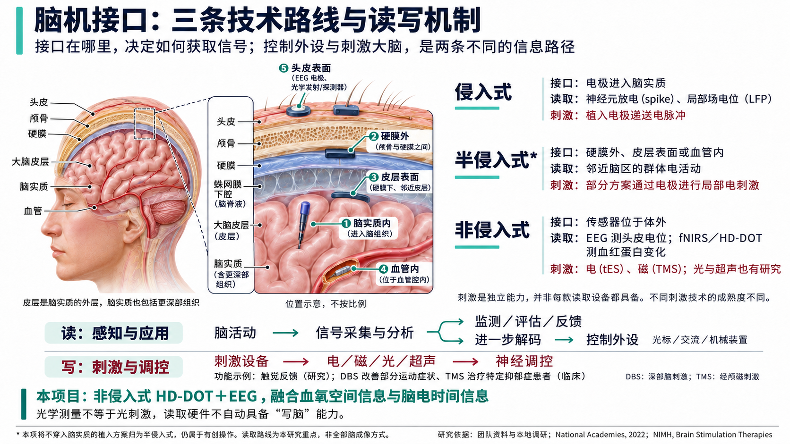
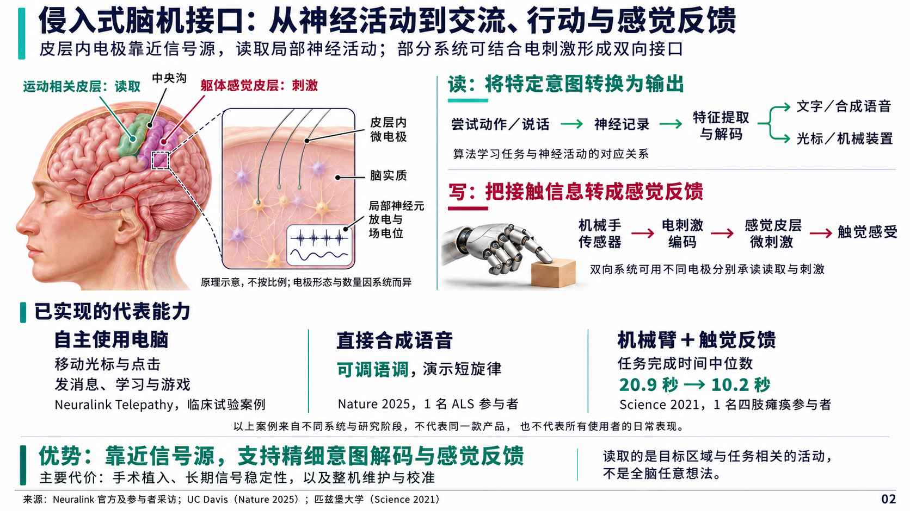
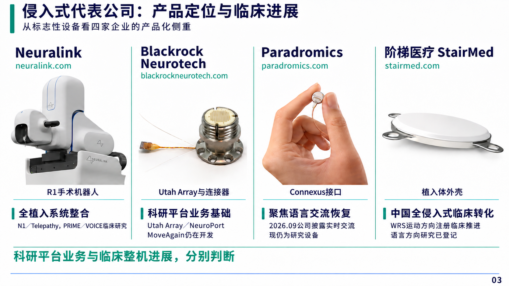
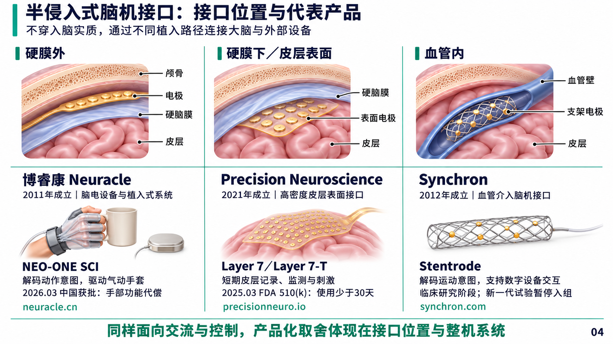

# 脑机接口行业与产品化机会研究：图片演示稿

当前已确认第1、2、3、4页。图片由 imagegen 制作，讲稿与对应页面配套，参考链接标为“不朗读”。

| 页码 | 主题 | 定稿图片 | 讲稿 | 可点击链接版 |
|---|---|---|---|---|
| 01 | 三条技术路线与读写机制 | [图片](01_定稿/第一页_技术路线与读写机制.png) | [讲稿](01_定稿/第一页讲解稿.txt) | [HTML](01_定稿/第一页讲解稿.html) |
| 02 | 侵入式技术与功能 | [图片](02_定稿/第二页_侵入式技术与功能.png) | [讲稿](02_定稿/第二页讲解稿.txt) | [HTML](02_定稿/第二页讲解稿.html) |
| 03 | 侵入式代表公司：产品定位与临床进展 | [图片](03_定稿/第三页_侵入式代表公司.png) | [讲稿](03_定稿/第三页讲解稿.txt) | [HTML](03_定稿/第三页讲解稿.html) |
| 04 | 半侵入式脑机接口：接口位置与代表产品 | [图片](04_定稿/第四页_半侵入式接口与代表产品.png) | [讲稿](04_定稿/第四页讲解稿.txt) | [HTML](04_定稿/第四页讲解稿.html) |

GitHub 可直接预览图片与 TXT。HTML 下载后用浏览器打开，可直接点击报道及论文链接。

## 第一页

## 第二页

## 第三页

[第三页可点击展示版](03_定稿/第三页_可点击展示版.html)：下载同目录文件后打开，可点击公司官网和讲稿来源。

第三页于2026-11-14定稿：采用删除图片来源括注及底部小字的版本；配套讲稿包含成立时间、公司长期聚焦、行业角色及产品进展。03_草稿保留历史，不代表当前定稿。

## 第四页

第四页将半侵入式技术与代表公司合并，上方三种接口位置，下方对应产品。2026-11-14经用户确认定稿。

后续顺序：非侵入式技术路线（第五页）、非侵入式公司与商业化、路线比较、本项目定位。第五页仅预览，尚未定稿。
